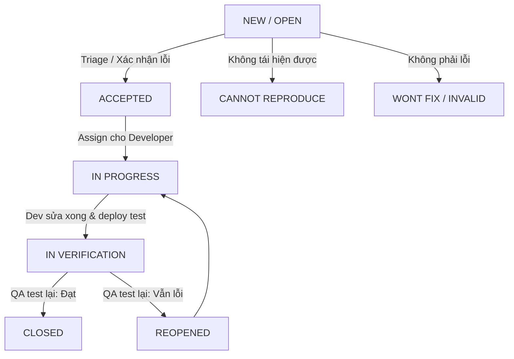

# Chuẩn Quản Lý Lỗi & Quy Trình Bug Tracking Trên Jira

Tài liệu này chuẩn hóa quy trình báo cáo lỗi (Defect Reporting) và vòng đời xử lý lỗi (Defect Life Cycle) trên **Jira Software** cho dự án **InternetCafe Management System**.

---

## 1. Vòng Đời Của Lỗi (Defect Life Cycle) Trên Jira

Quy trình xử lý một lỗi phần mềm từ lúc Tester phát hiện đến khi hoàn tất sửa lỗi:



### Phân biệt Severity (Mức độ nghiêm trọng) vs Priority (Độ ưu tiên):
- **Severity** (Kỹ thuật): Mức độ ảnh hưởng của lỗi tới hệ thống.
  - `Blocker`: Làm sập server, mất dữ liệu, chặn toàn bộ quy trình thanh toán.
  - `Critical`: Lỗi bảo mật nghiêm trọng (SQL Injection, IDOR, hack số dư).
  - `Major`: Một chức năng chính không hoạt động nhưng có giải pháp thay thế tạm thời.
  - `Minor`: Lỗi hiển thị, sai định dạng tiền tệ hoặc ngày giờ.
  - `Trivial`: Lỗi chính tả, sai màu nút nhẹ.
- **Priority** (Kinh doanh): Tốc độ cần phải sửa lỗi (P1 - Immediate, P2 - High, P3 - Medium, P4 - Low).

---

## 2. Tiêu Chuẩn Mẫu Báo Cáo Lỗi (Jira Bug Template)

Một Bug Ticket chuẩn trên Jira bắt buộc gồm các trường sau:

```markdown
**Summary**: [Tên Phân Hệ] Mô tả ngắn gọn lỗi xảy ra trong hoàn cảnh nào
**Issue Type**: Bug
**Component**: Authentication | Computer Fleet | Billing & Wallet | F&B & MRP | HRM
**Affects Version**: v1.0.0-beta
**Environment**: Windows 11, Google Chrome 120+, SQL Server LocalDB, .NET 10 Web API
**Priority**: High / Highest
**Severity**: Critical / Major

### 1. Mô tả tóm tắt (Description)
Tóm tắt ngắn gọn hành vi sai lệch của hệ thống so với tài liệu đặc tả yêu cầu (SRS).

### 2. Các bước tái hiện (Steps to Reproduce)
1. Bước 1...
2. Bước 2...
3. Bước 3...

### 3. Kết quả thực tế (Actual Result)
Hệ thống phản hồi gì (Mã lỗi, nội dung trả về, hành vi giao diện).

### 4. Kết quả mong đợi (Expected Result)
Hệ thống phải hoạt động như thế nào theo đúng nghiệp vụ.

### 5. Dữ liệu thử nghiệm & Bằng chứng (Evidence)
- Test Data: ...
- Request Payload / Response Body: ...
- Screenshot / Log File đính kèm: ...

### 6. Phân tích nguyên nhân & Đề xuất giải pháp (Root Cause Analysis - RCA)
- Phân tích vị trí code hoặc câu query gây lỗi.
- Đề xuất hướng fix cho Developer.
```

---

## 3. Các Bug Tickets Mẫu Thực Tế Của Dự Án InternetCafe

Dưới đây là 3 Bug Tickets tiêu biểu được chuẩn bị sẵn từ kết quả kiểm thử thực tế để bạn thực hành tạo trên Jira:

### Bug 1: [CYBER-101] Thiếu ràng buộc số dương gây lỗi thao túng giỏ hàng (Cart Tampering)
- **Summary**: `[POS/Orders] API /orders chấp nhận số lượng món âm, cho phép khách hàng tạo đơn hàng có giá trị âm`
- **Issue Type**: Bug | **Priority**: P1 - High | **Severity**: Critical
- **Component**: F&B & MRP
- **Steps to Reproduce**:
  1. Khách hàng mở máy và bắt đầu phiên chơi tại `pc-001`.
  2. Gửi request `POST /api/v1/orders` với body:
     ```json
     {
       "computerId": "pc-001",
       "items": [{ "productId": "p-001", "quantity": -5 }]
     }
     ```
- **Actual Result**: Trước khi vá lỗi, API chấp nhận số lượng âm, dẫn tới tổng tiền đơn hàng bị âm $(-125.000đ)$ và tự động cộng thêm số dư ví thay vì trừ tiền.
- **Expected Result**: API phải trả về `422 Unprocessable Entity` kèm mã lỗi `VALIDATION_ERROR`, từ chối đơn hàng có số lượng $\le 0$.
- **RCA**: Trong `BusinessService.cs`, DTO chưa có Data Annotation `[Range(1, 100)]` trên trường `Quantity`.

---

### Bug 2: [CYBER-102] Khách hàng bị lỗi 409 INSUFFICIENT_BALANCE khi nạp tiền nhầm ID người dùng
- **Summary**: `[Billing/Topup] Lệnh nạp tiền thu ngân bị lệch mục tiêu người dùng do danh sách trả về sắp xếp theo họ tên`
- **Issue Type**: Bug | **Priority**: P2 - Medium | **Severity**: Major
- **Component**: Billing & Wallets
- **Steps to Reproduce**:
  1. Thu ngân mở giao diện nạp tiền.
  2. Lấy người dùng đầu tiên từ API `/customers` (trả về sắp xếp theo họ tên).
  3. Nạp 20.000đ vào tài khoản đó.
  4. Hội viên `gamer` (`c-001`) tiến hành gọi món 25.000đ.
- **Actual Result**: Đơn hàng của `gamer` bị từ chối với lỗi `409 Conflict (INSUFFICIENT_BALANCE)` do tiền được nạp vào tài khoản mới tạo thay vì tài khoản của `gamer`.
- **Expected Result**: Thu ngân phải chọn chính xác mã hội viên theo username/id của khách hàng đang ngồi máy; số dư tài khoản gọi món phải được cập nhật tương ứng.
- **RCA**: Kiểm thử tự động đã bộc lộ điểm yếu khi gán mặc định phần tử đầu tiên mà không lọc theo `username`.

---

### Bug 3: [CYBER-103] Rò rỉ thông tin phân biệt đối tượng trong API tra cứu chi tiết (IDOR Vulnerability)
- **Summary**: `[Security/IDOR] Endpoint /{resource}/{id} trả về mã 404 thay vì 403 khi khách hàng cố tình đoán mã đối tượng của khách khác`
- **Issue Type**: Bug | **Priority**: P2 - Medium | **Severity**: Minor
- **Component**: Security & Row-Level Authorization
- **Steps to Reproduce**:
  1. Đăng nhập tài khoản khách `gamer` (`c-001`).
  2. Gửi request `GET /api/v1/customers/c-002`.
- **Actual Result**: Trả về `404 Not Found` kèm thông điệp `"Không tìm thấy dữ liệu hoặc bạn không có quyền xem."`.
- **Expected Result**: Hành vi trả về 404 là một kỹ thuật phòng thủ chủ động (Defense-in-Depth) đúng đắn nhằm ngăn chặn kẻ tấn công biết mã `c-002` có tồn tại trên hệ thống hay không (chống Enumeration Attack).
